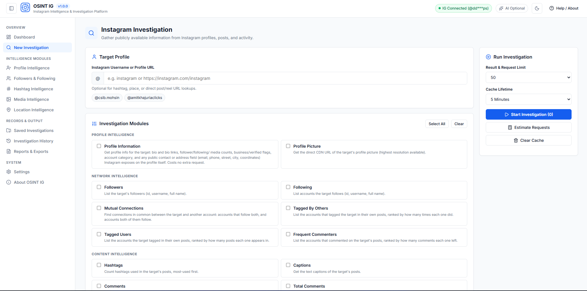

# OSINT IG

**Instagram Intelligence & Investigation Platform**  
Developed by **Mohsin Khawaja** — **CSIB (Cyber Solutions & Information Board)**

OSINT IG is a local-first Instagram intelligence and digital forensics web platform with a modern GUI (Light & Dark themes). It collects, structures, and exports profile, network, content, media, and location intelligence using an authorized `instagrapi` session, with optional post-collection analysis powered by Google Gemini.



---

## Key Features & GUI Capabilities

- **Investigation Dashboard**: Live stats for saved investigations, reports, recent targets, Instagram session status, and step-by-step workflow guide.
- **27 Intelligence Modules**:
  - **Profile**: Profile Information, Profile Picture.
  - **Network**: Followers, Following, Mutual Connections, Tagged By Others, Tagged Users, Frequent Commenters.
  - **Content**: Hashtags, Captions, Comments, Total Comments, Likes Statistics, Posting Activity, Post Comments.
  - **Media**: Media Breakdown, Photos & Videos (with clickable previews & ZIP download), Stories, Highlights, Media Alt Metadata.
  - **Location & Discovery**: Geotagged Locations (interactive Leaflet map with Street, Light, and Satellite layers), Place Search, Hashtag Search.
  - **Public Contacts**: Followers/Following Public Emails & Phone Numbers.
- **Live Terminal Logs & Expandable Modal**: Stream backend requests in real time and expand logs into a full-screen modal for clear inspection.
- **Full Case ZIP & Branded Reports**:
  - **Case ZIP**: Bundles `report.html`, `report.json`, `report.csv`, `manifest.json`, `ai_analysis.md`, `raw_evidence/*.json`, `lists/` (emails, phone numbers, followers, following, hashtags, locations, captions), and downloaded `media/`.
  - **Single-File Exports**: JSON, CSV, HTML, and Print-to-PDF.
- **Saved Investigations & Diffs**: Reopen saved dossiers from disk without re-querying Instagram, and compare two runs of the same target.
- **Light & Dark Theme**: Instant toggle in the top bar or **Settings → Storage & General**.
- **Optional Google Gemini AI Analysis**: Post-collection analysis (Profile Summary, Hashtag Analysis, Engagement Analysis, Posting Pattern, Q&A, etc.) that strictly separates Observed Facts, Derived Statistics, AI Interpretations, and Unknowns. All OSINT features work without an AI key.

---

## Installation & Setup

### Prerequisites
- **Python 3.10+** (recommended: 3.11 or 3.12)
- **Git**

### 1. Windows (PowerShell)

```powershell
git clone https://github.com/csibmohsin/OSINT-IG.git
cd OSINT-IG

python -m venv .venv
.\.venv\Scripts\Activate.ps1
pip install -r requirements.txt

uvicorn osint_ig.api.app:app --host 127.0.0.1 --port 8000
# or:
python -m osint_ig serve
```

> If PowerShell blocks script activation, run `Set-ExecutionPolicy -Scope CurrentUser RemoteSigned` or invoke `.\.venv\Scripts\python.exe -m osint_ig serve` directly.

### 2. Linux & macOS (Bash / Zsh)

```bash
git clone https://github.com/csibmohsin/OSINT-IG.git
cd OSINT-IG

python3 -m venv .venv
source .venv/bin/activate
pip install -r requirements.txt

uvicorn osint_ig.api.app:app --host 127.0.0.1 --port 8000
# or:
python -m osint_ig serve
```

> On Debian/Ubuntu, if `python3 -m venv` is missing, install it first: `sudo apt update && sudo apt install -y python3-venv python3-pip`.

### 3. Docker

```bash
git clone https://github.com/csibmohsin/OSINT-IG.git
cd OSINT-IG

docker compose up --build
```

Then open **http://127.0.0.1:8000** in your browser.

---

## Instagram Authentication & Configuration

1. Open **http://127.0.0.1:8000** and go to **Settings → Instagram Connection**.
2. Choose either:
   - **Direct Login (Username & Password):** Enter your Instagram username and password and click **Login & Save Credentials**. Use **Verify Connection** at any time to confirm the active session.
   - **Browser Session ID:** Paste your Instagram `sessionid` cookie from a logged-in browser session and click **Save Session ID** (useful if Instagram challenges direct password login from your IP).
   - **CLI Helper:** Alternatively, run `python -m osint_ig auth` (or `python -m osint_ig auth --sessionid <cookie>`).
3. **Private Accounts:** If your logged-in Instagram account already follows a private target account, all modules work on that target just like a public profile. If you do not follow the private account, only basic public profile metadata is accessible.
4. *(Optional)* Configure a **Google Gemini API key** in **Settings → AI Configuration** for post-collection AI analysis.

See [docs/operator-guide.md](docs/operator-guide.md) and [NOTICE.md](NOTICE.md) for architecture and GPL-3.0 attribution details.

---

## Terms & Conditions

- **Use at Your Own Risk:** You use **OSINT IG** entirely at your own risk.
- **OSINT & Research Purpose Only:** This platform is intended strictly for Open Source Intelligence (OSINT), authorized security research, digital forensics, and educational purposes.
- **Sole Responsibility:** You are solely responsible for any unlawful, unauthorized, or non-compliant activity and for complying with applicable laws and platform Terms of Service. The developer (**Mohsin Khawaja**) assumes no liability for misuse.

---

## Development & Tests

**Windows (PowerShell):**
```powershell
.\.venv\Scripts\pip.exe install -r requirements-dev.txt
.\.venv\Scripts\python.exe -m pytest
```

**Linux / macOS (Bash):**
```bash
pip install -r requirements-dev.txt
pytest
```
